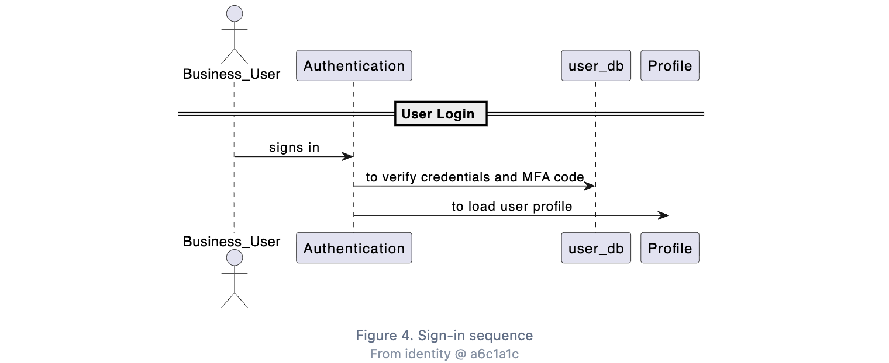
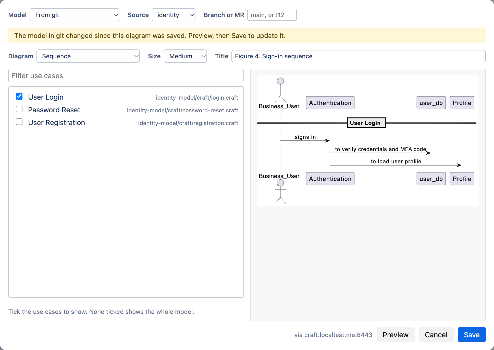
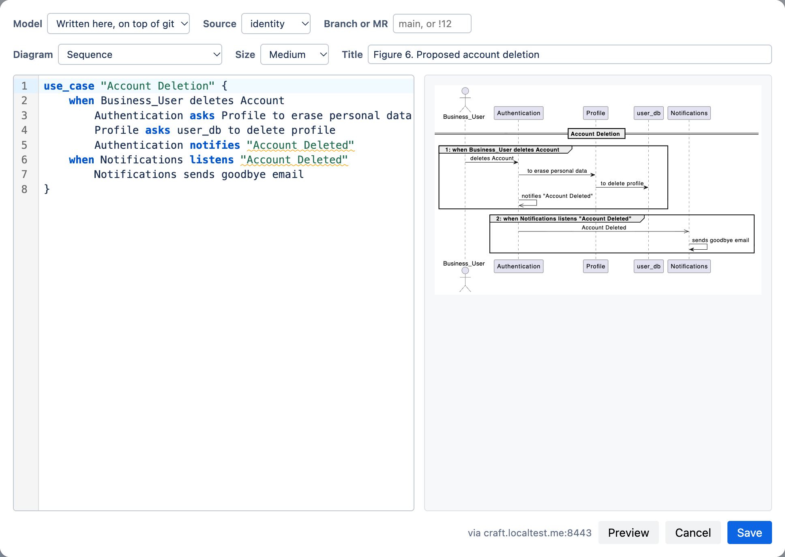

# arch-craft-confluence

A Confluence Cloud macro, **arch-craft**, that puts [Craft](https://github.com/tcarcao/craft) diagrams in pages. The diagram is rendered by your own craft server, which can stay on your internal network, and stored with the page, so readers never touch the server.



## What it does

- **Three ways to provide the model:**
  - **Written here:** the craft source lives in the macro.
  - **From git:** pick use cases from a model kept in a git repo; the macro stores only the selection.
  - **Written here, on top of git:** write a new use case in the macro and render it against the contexts, services and stores already defined in git. Useful for design docs that propose something new.
- **Branches and merge requests:** render from any branch, or from a GitLab merge request with `!12`, before it is merged.
- **Drift notice:** when the model in git changes after a diagram was saved, the editor says so the next time the macro is opened. Nothing changes on the page until someone saves.
- **Draft to git:** once a drafted use case is merged, the editor offers to switch the macro to read it from git.
- **Diagram types:** C4 containers (with or without boundaries), domain architecture, domain flow and sequence.
- **Editor:** syntax highlighting, server diagnostics shown on the right line, preview next to the code.
- **Display:** SVG output, four widths, and a caption that fills itself from the model until you write your own.

| From git | Written here, on top of git |
| --- | --- |
|  |  |

## How it works

```
 editor's browser ──(1) render request──▶ your craft server (internal, HTTPS)
        │                                        │
        │◀────────────(2) SVG─────────────────────┘
        │
        └──(3) upload as page attachment──▶ Confluence
                                                │
 reader's browser ◀──(4) attachment only────────┘
```

1. The editor panel calls the craft server **from the browser**. Forge functions run in Atlassian's cloud and cannot reach an intranet, but the editor's browser can (over VPN, for example).
2. The server returns an SVG. For git sources it reads the repos itself, so tokens stay on the server.
3. The SVG is saved as an attachment on the page, and the macro stores the attachment id plus a hash of what was rendered. Saving again without changes keeps the stored diagram instead of uploading a new one.
4. Readers load the attachment through Confluence. They make no calls to the craft server and need no access to it.

## Getting started

You need three things running, in this order:

1. **A craft server** reachable over HTTPS from your users' browsers: [docs/server.md](docs/server.md).
2. **The app** registered under your own Atlassian developer account and installed on your site: [docs/install.md](docs/install.md).
3. **The server approved** by a site admin from the macro editor (one click, also in [docs/install.md](docs/install.md#4-approve-the-craft-server)).

Then see [docs/usage.md](docs/usage.md) for writing and picking diagrams.

To try everything on one machine first, follow [docs/local-development.md](docs/local-development.md).

Not an admin yourself? [docs/rollout.md](docs/rollout.md) lists who in your organisation does which step, and has a request you can send them.

## Requirements

- Confluence Cloud.
- Node.js 22 or later, and Forge CLI 14 or later (older versions reject the egress setting this app uses).
- A craft server v2.28.0 or later: the macro needs its browser CORS fix and the `/sources` endpoints.
- HTTPS on the craft server. Forge only approves `https://` domains.

## Known limitations

- Clicking a diagram does not open it full size yet.
- When a macro's diagram type or source changes, the previous attachment stays on the page.
- A diagram read from git only updates when someone opens the macro and saves. This is on purpose: pages never change without an editor.
- C4 diagrams always show the whole model; the use case selection does not apply to them.
- The app uses customer-managed egress, so it is not eligible for Atlassian's "Runs on Atlassian" badge.

## License

[MIT](LICENSE)
